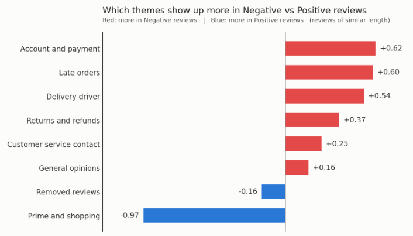
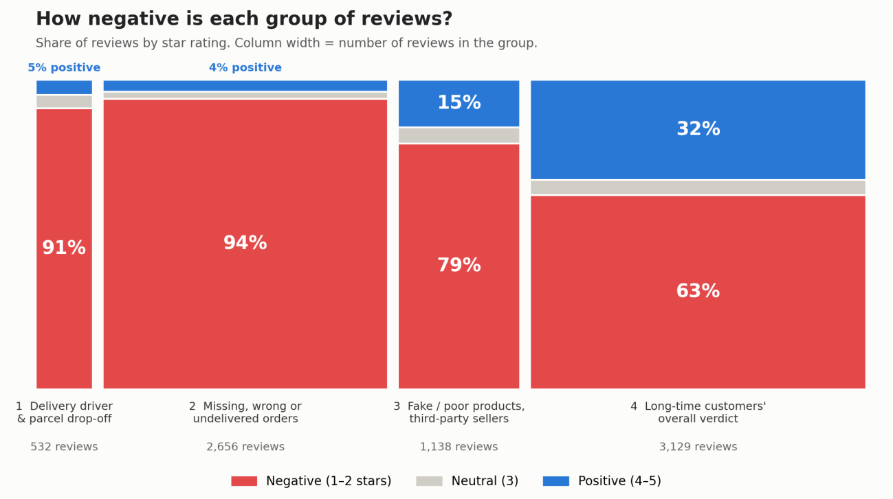

# What Do Negative and Positive Amazon Reviews Talk About?

A text-mining case study of 18,130 customer reviews of Amazon (2018-2024), done in JMP as a graduate business analytics project.

**Goal:** find which words and themes separate negative (1-2 star) reviews from positive (4-5 star) reviews, and turn thousands of written reviews into a few themes a business can act on.

## Key findings

- **Specific failures drive negative reviews.** Delivery drivers leaving parcels in the wrong place, missing or wrong orders, and fake or poor-quality third-party products were the themes most tied to 1-2 star reviews. Between 79% and 94% of reviews in these clusters were negative.
- **Positive reviews are mostly general praise.** About 77% of positive reviews fell into one cluster: long-time customers giving an overall verdict. Prime and shopping experience is the only topic that clearly leans positive.
- **Most common phrase:** "customer service" (8,319 mentions), followed by "next day", "gift card", "prime member", and "money back".
- **Recommendations:** improve delivery reliability and driver handling of parcels, fix order accuracy and missing-order handling, tighten control of third-party sellers, and protect the Prime experience.

## Results

| Cluster | Reviews | Negative | Neutral | Positive |
|---|---|---|---|---|
| 1. Delivery driver and parcel drop-off | 532 | 90.8% | 4.3% | 4.9% |
| 2. Missing, wrong or undelivered orders | 2,656 | 93.9% | 2.2% | 3.9% |
| 3. Fake or poor-quality products, third-party sellers | 1,138 | 79.4% | 5.2% | 15.4% |
| 4. Long-time customers' overall verdict | 3,129 | 62.7% | 4.9% | 32.4% |
| All reviews (similar length) | 7,455 | 78.4% | 3.9% | 17.7% |

## Approach

1. **Data:** Amazon Reviews dataset from Kaggle ([dongrelaxman/amazon-reviews-dataset](https://www.kaggle.com/datasets/dongrelaxman/amazon-reviews-dataset)). 21,214 reviews received, 18,130 kept after cleaning and keeping 2018-2024. Review title and text were combined into one column.
2. **Text Explorer (JMP):** counted words and phrases, combined similar word forms (stemming), and removed rare and filler words.
3. **Topic Analysis (JMP):** grouped words that appear together into 10 topics (rotated SVD, TF-IDF weighting). Two topics were only symbols and foreign text and were ignored.
4. **Cluster Analysis (K-Means, JMP):** sorted reviews into 4 clusters, chosen using the Cubic Clustering Criterion, then checked the share of negative and positive reviews in each.
5. **Length control:** negative reviews were much longer than positive ones, so topic and cluster comparisons use reviews of similar length (150-450 characters, 7,455 reviews).

## Limitations

These are reviews of Amazon as a company, written by people who chose to post, and 78% of them are negative. The results describe reviewers, not all customers. Cluster names are my own interpretation after reading review titles and ratings in each cluster.

## Files

- [`Amazon_Reviews_Text_Mining_Report.pdf`](Amazon_Reviews_Text_Mining_Report.pdf): full report
- [`Appendix_Technical_Details.pdf`](Appendix_Technical_Details.pdf): technical details and decision log
- `images/`: figures used above

The dataset is not included. Download it from the Kaggle link above.

## Tools

JMP (Text Explorer, Topic Analysis, K-Means Cluster Analysis)

## Author

Amir Ali | [LinkedIn](https://linkedin.com/in/amir-ali-6b677929b)
